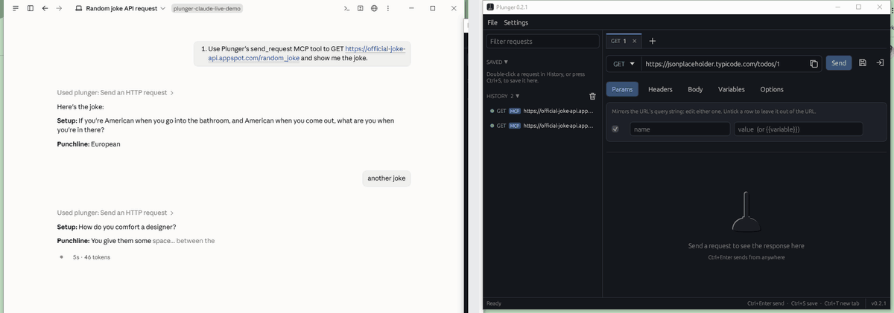
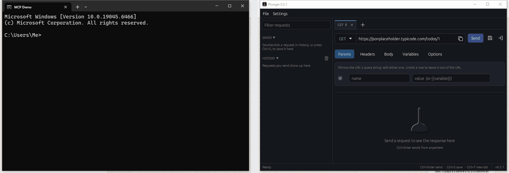

# Plunger for AI agents

Plunger is one executable with three ways in:

| You run | You get |
|---|---|
| `plunger.exe` | The window. |
| `plunger.exe <command>` | The command line: JSON on stdout, meaningful exit codes. |
| `plunger.exe mcp` | An MCP server on stdin/stdout, for Claude Code, Cursor and other MCP clients. |

All three send requests through the same engine as the window's Ctrl+Enter, and all three write to the same local history. You can open Plunger afterwards and see exactly what an agent sent.

## Why not just let the agent run curl?

- **Undefined variables are refused.** A request with an undefined `{{variable}}` is never sent. curl would send the placeholder text.
- **Secrets stay by name.** Secrets you've chosen to remember (the key icon on a secret variable or the Bearer field) live in Windows Credential Manager, and only those are available to an agent. The agent writes `{{token}}`; Plunger fills it in. No tool output contains a secret value, and if a server echoes one back, it is replaced with `[redacted:token]`.
- **Structured results.** Status, time, size, headers and the parsed JSON body come back as separate fields, and long bodies are cut to a size a model can read.
- **An audit trail.** Every agent request lands in Plunger's history, tagged `MCP` or `CLI`, and the window picks it up live.

## Make agents use Plunger, not curl

Registering the server is not enough: an agent still reaches for `curl` or `Invoke-RestMethod` out of habit. `plunger install` does both halves, in each tool's own format:

```bash
plunger install                       # the tools it finds, for the current project folder
plunger install claude-code cursor    # or name them: claude-code, cursor, kiro, codex, windsurf, vscode, gemini
plunger install all --scope user      # every project of this user
plunger install --dry-run             # show what would change, write nothing
plunger install --via uvx             # start the server with `uvx plunger-cli mcp` (nothing to keep in place)
```

In the window, **File > Set up AI agents...** shows the same choices, lists the files it would change, and writes them when you press Install.

| Tool | MCP server registered in | Always-on steering written to |
|---|---|---|
| Claude Code | `.mcp.json` (project) or `~/.claude.json` (user) | `CLAUDE.md` block and a `plunger` skill under `.claude/skills/` |
| Cursor | `.cursor/mcp.json` or `~/.cursor/mcp.json` | `.cursor/rules/plunger.mdc` (`alwaysApply: true`) |
| Kiro | `.kiro/settings/mcp.json` or `~/.kiro/settings/mcp.json` | `.kiro/steering/plunger.md` (`inclusion: always`) |
| Codex | `~/.codex/config.toml` | `AGENTS.md` block (project) or `~/.codex/AGENTS.md` |
| Windsurf | `~/.codeium/windsurf/mcp_config.json` | `.windsurf/rules/plunger.md` (always on) |
| VS Code (Copilot) | `.vscode/mcp.json` | `.github/copilot-instructions.md` block |
| Gemini CLI | `.gemini/settings.json` or `~/.gemini/settings.json` | `GEMINI.md` block |

Existing settings are kept (the config is parsed and merged; a file that is not valid JSON is left alone), a `.plunger-backup` copy is kept beside anything it changes, shared files like `CLAUDE.md` only get a block between `<!-- plunger:start -->` and `<!-- plunger:end -->`, and running it twice changes nothing. The steering text is [docs/steering/plunger.md](steering/plunger.md): copy it into any other tool's rules by hand.

## Why the responses are small

The point of Plunger for an agent is fewer tokens and fewer calls:

- `select` returns only the values asked for (`["$.data[0].id", "$.items[*].name", "status"]`; `[*]` collects a field from every item of an array) instead of the whole body, and leaves the response headers out (ask for one as `header:Name`). `[?(@.name=='Done')]` keeps the items whose field equals a value, so `$.transitions[?(@.name=='Done')].id` finds a Jira transition by name; `extract` with such a path hands over the one matching value, and fails clearly when none or several match. A path through a `null` (an unassigned `assignee`) is `null`, not an error. If a path cannot be read (an error page that is not JSON, say) the whole response comes back instead, with the reason in `problems`, so the request never has to be sent twice to see what happened.
- A JSON body over `max_body_chars` (default 50,000) comes back as an **outline**: its keys, types, array lengths and one example each, in a few hundred tokens, with a hint to use `select`. It no longer returns cut-off text.
- `extract` keeps a value (a token, an id) as a variable in the same call, so a login and the request after it need no copy and paste.
- Workflows run a whole sequence in one call.

## Set it up in Claude Code

Add Plunger to your project's `.mcp.json` (use the path where you unzipped it):

```json
{
  "mcpServers": {
    "plunger": {
      "command": "C:\\Tools\\plunger\\plunger.exe",
      "args": ["mcp"]
    }
  }
}
```

Or from a terminal:

```bash
claude mcp add plunger -- "C:\Tools\plunger\plunger.exe" mcp
```

With Python installed (from 0.5.1), `pip install plunger-cli` (or `pipx install plunger-cli`) gives you the `plunger` command, and with uv there is nothing to download: `claude mcp add plunger -- uvx plunger-cli mcp`, or in `.mcp.json` use `"command": "uvx", "args": ["plunger-cli", "mcp"]`. The `plunger-cli` package on PyPI is just the compiled program in a platform wheel (Windows, Linux, macOS), with no Python code in it.

Any MCP client that can launch a stdio server works the same way: the command is `plunger.exe` and the only argument is `mcp`.

Once it's added, an agent's calls show up in Plunger's own history live, tagged `MCP`. This is real Claude Code, unedited, asked to fetch a joke through Plunger and then asked twice more:

<p align="center">
  
</p>

### Seeing the raw protocol

Claude Code's chat hides the actual bytes on the wire behind "Used plunger: Send an HTTP request." If you're building your own MCP client and want to see the literal JSON-RPC frames, [`scripts/mcp-demo-client.py`](../scripts/mcp-demo-client.py) is a minimal reference client with no SDK — it does the same initialize handshake and one `tools/call`, and prints every frame:

```bash
python scripts/mcp-demo-client.py path\to\plunger.exe
```

<p align="center">
  
</p>

## MCP tools

| Tool | What it does |
|---|---|
| `send_request` | Sends a request and returns `status`, `ok`, `elapsed_ms`, `size_bytes`, `headers`, and the body (`json` when it parses, otherwise `body`). Send a saved request by name with `saved_request`, or describe one with `method`, `url`, `headers`, and one of `json`, `body` or `form`. `variables` adds or overrides `{{variables}}` for this request only. `extract` keeps values from the response as variables (`[{"name": "token", "from": "json:$.access_token"}]`; `from` is `json:$.path`, `header:Name` or `status`), so a login and its token take one call. `select` (`["$.data[0].id", "header:Location"]`) returns just those values under `selected` instead of the whole body and headers. `request.sent_at` is when it was fired. |
| `import_curl` | Parses a curl command into a request without sending it. With `save_as`, adds it to the Saved list. |
| `save_request` | Saves a request without sending it, described like `send_request` plus a `name`. `{{placeholders}}` (even in `Authorization: Bearer {{token}}`) are kept. An existing name is refused unless `overwrite` is true, so a mistake can be fixed. |
| `get_saved_request` | One saved request in full: method, URL, headers, body, the variables it needs, and `options` (its `timeout_secs`, `follow_redirects`, `insecure_tls` and `select`, when it has any). |
| `delete_saved_request` | Removes a saved request (history stays). |
| `list_saved_requests` | The user's saved requests: name, method, URL, headers, and the `{{variables}}` each one needs (an environment variable shows as `$env:NAME`). |
| `get_history` | Recent requests, newest first, with who sent each (`gui`, `cli` or `mcp`). Narrow it with `search` (URL, method, name or status), `status` (`401`, `4xx`, `5xx`, `ok`, `fail`, `error`), `min_ms` (the slow ones), `source`, and `saved_request` (how one saved request has been doing). Credentials are blanked. |
| `get_history_entry` | One history entry in full by id: when it was sent, status and time, and the request as sent (credentials blanked, `{{placeholders}}` kept). The response body is not stored. |
| `list_variables` | Variable names and where each came from (`window` or `agent`); values only for non-secret variables. Also says whether a saved Bearer token is available. |
| `set_variable` | Keeps a value for later requests as `{{name}}`, for example a token read from a login response. It persists, is shared with the window and the command line, and appears in the window under "Set by agents". A secret, or a name like `token` or `api_key`, is kept in the system credential store and masked in results. |
| `delete_variable` | Removes a variable an agent set. The user's own variables cannot be changed or removed by an agent. |
| `export_curl` | A saved request or history entry as a curl command, with `{{variables}}` left as placeholders. |
| `save_workflow` | Saves a workflow: ordered steps, each described like `send_request`, plus `extract` and `expect_status`. See [Workflows](#workflows). |
| `run_workflow` | Runs a workflow by name, optionally with `variables` for every step. Returns each step's status and the variables it set (secrets by name only), and the last response in full. |
| `list_workflows` / `delete_workflow` | List the saved workflows with their steps, or remove one. |

The read-only tools are marked as such, so a client can run them without asking.

## The audit log

Every change Plunger makes to its history is written to `audit.log` first and applied to the database from it: sends (who, when, what, status), saved requests, groups, workflows and their runs, and the variables an agent sets (a secret by name only, never its value). Each line carries the hash of the line before it.

```bash
plunger audit verify                    # ok with the entry count and head hash, or the first bad entry (exit 4)
plunger audit show --source mcp --since 1h --action send
plunger audit head                      # the newest hash, to write down somewhere else
plunger audit rebuild                   # recreate the database from the log
```

An agent cannot read or write it: there is no MCP tool for it. What it stops: an edit to the file made without going through Plunger shows up in `verify`. What it does not stop: a process running as you that rewrites the whole file and its hashes (the keyed version is planned, #201).

## What comes back

- `status`, `ok`, `elapsed_ms` and `ttfb_ms` (until the headers arrived), `size_bytes`.
- A JSON body as `json`, or its outline when it is long; any other text as `body`, cut at `max_body_chars`.
- A redirect: `final_url` and `redirects` (`[{"status": 301, "url": "..."}]`) when the request was redirected; absent otherwise.
- A binary body is never returned: `binary: true`, `sha256` and `detected_type` let you check it. On the command line `--out FILE` writes the whole body to a file and the result carries `body_file`.
- `headers` as `include_headers` says: `all` (the default), `none`, or `relevant` (location, link, retry-after, content type and disposition, etag, rate-limit headers, and a cookie's name without its value). With `select` the default is `none`; `header:Name` in `select` returns one.

## Variables in a JSON body

A `{{variable}}` inside a JSON string is JSON-escaped for you: a description with a line break, a quote or a backslash arrives as exactly that text, so do not escape it yourself (a value you already escaped would arrive with a visible backslash). Outside a string the value is inserted as JSON, so a variable can be a number, `true`, or a whole array or object:

```json
{"fields": {"summary": "{{summary}}", "priority": {{priority}}, "labels": {{labels}}}}
```

with `labels` set to `["backend", "urgent"]`. Only the JSON body is treated this way; a raw or form body, headers and the URL take the value as it is (the query string is percent-encoded).

### Defaults and optional values

An undefined `{{name}}` refuses the request, so a request never goes out with a literal placeholder. Two marks say a value may be missing (an empty value counts as missing):

- `{{name|default}}` uses `default` when there is no value: `"priority": "{{priority|Medium}}"`, `/search?limit={{limit|20}}`. The default is the text as written after the `|`, escaped like any value.
- `{{name?}}` is optional. In a JSON body the whole member (or array item) is left out when there is no value: `"assignee": {"name": "{{who?}}"}` disappears (an object that the omission leaves empty goes too, one that was empty in your template stays), and so do `"labels": {{labels?}}` and `"epic": "{{epic?}}"`. Elsewhere (the URL, a header, a raw body) it is empty. A body with nothing left out is sent exactly as written; when something is left out the body is re-written as compact JSON.

One request can then create an issue with an optional assignee, labels and epic.

A request you save with `save_request` keeps its `timeout_secs`, `follow_redirects`, `insecure_tls` and `select`, and uses them when it is sent by name (a value in the call wins). Fields a saved request cannot keep (`variables`, `use_saved_bearer`, `extract`, `max_body_chars`) are named in `not_saved` in the result.

## Groups

Saved requests and workflows can be filed under a group so unrelated APIs do not mix: `Jira`, or `Jira/Issues` for one level under it. A group is just a name; there is nothing to create first.

- `save_request` and `save_workflow` take `group`. Left out, a new one has no group and a replaced one keeps its group; an empty string takes it out of its group.
- `list_saved_requests` and `list_workflows` take an optional `group`, and return each item's `group`. `Jira` includes `Jira/Issues`.
- `set_group` (`kind`: `request` or `workflow`, `name`, `group`) files one without sending its content again, so an agent can tidy a long flat list.
- On the command line: `plunger save "create issue" ... --group Jira`, `plunger saved --group Jira`, `plunger saved group "create issue" Jira/Issues`, `plunger workflow save close @steps.json --group Jira`, `plunger workflow list --group Jira`, `plunger workflow group close Jira`.
- In the window, the sidebar shows a collapsible header per group, and **Move to group** is on a row's right-click menu.

Variables stay shared by everything (see Variables in the window); per-group variables are a possible next step.

## Workflows

A workflow is a saved list of requests where a later one can use a value from an earlier response, for example log in, then call the API with the token. A step is a request (a saved one by name, or `method` / `url` / `headers` / `json` / `body` / `form`) plus:

- `extract`: `[{"name": "token", "from": "json:$.access_token"}]` keeps a value as `{{token}}` for the steps after it. `from` is `json:$.a.b[0]`, `header:Name` or `status`. A name like `token` or `password` (or `"secret": true`) goes to the system credential store and is never shown, but it is used in the next request. The value is read from the response as the server sent it, before any secret is masked. `"scope": "run"` keeps the value for the later steps of this run only: nothing is stored, so nothing is left behind for the next run or another agent.
- `expect_status`: the status the step must return, or a list of acceptable ones (`[200, 404]`). Without it any 2xx passes. A failing step stops the run.
- `skip_if` and `stop_if`: a condition that is checked before the step is sent. `skip_if` leaves the step out (it counts as passed) and goes on; `stop_if` ends the run there, successfully. A condition is `{{a}} == b`, `{{a}} != b`, or one value that is true unless it is empty, `false`, `0` or `null`; a variable with no value is empty, not an error. `{{previous_status}}` is the status of the last step that was sent, so "look it up, create it only if it is missing" is `expect_status: [200, 404]` on the lookup and `skip_if: "{{previous_status}} == 200"` on the create.

```json
[
  {"label": "log in", "method": "POST", "url": "{{base}}/login",
   "json": {"username": "{{username}}", "password": "{{password}}"},
   "extract": [{"name": "token", "from": "json:$.token"}]},
  {"label": "create an order", "method": "POST", "url": "{{base}}/orders",
   "headers": {"Authorization": "Bearer {{token}}"}, "json": {"item_id": 1, "qty": 2},
   "expect_status": 201, "extract": [{"name": "order_url", "from": "header:Location"}]}
]
```

From a terminal: `plunger workflow save shop @steps.json`, `plunger workflow run shop --var base=http://localhost:8080` (exit code 4 when a step fails), `plunger workflow list|show|delete`. Variables a workflow sets stay afterwards and show in the window under "Set by agents", unless a step used `"scope": "run"` or the run was made with `--cleanup` (`cleanup: true` over MCP), which removes the variables the run stored once it is done.

## Workflows in the window

<p align="center">
  
</p>

Workflows are made by agents (or `plunger workflow save`), but the window shows them: a **WORKFLOWS** section in the sidebar lists each one with its step count and a dot for its last run (green all passed, red a step failed, amber cancelled, grey never run) and how long ago.

Click one to open it. The window draws the steps as a flow: a card per step on a rail of connected dots (coloured by the last or running run; a diamond can be skipped, a square can end the run), with the values a step hands on written on the connector and what the workflow needs from outside listed on top. Each card shows the request, the status it expects and its conditions, **Run** with live progress and a **Cancel** that stops before the next step, an optional "Values for this run" box (`name=value`, one per line), and **Last run**: every recorded run, whoever made it (you, the CLI or an agent over MCP), with each step's status, time and the variables it set (by name; a secret never shows). **Open as request** puts a step in an ordinary tab to try by hand, and **Copy as JSON** copies the steps. Right-click a workflow in the sidebar for Open, Run, Copy as JSON and Delete (which asks first, and removes its recorded runs too).

A run from the window uses the same engine, variables and history as an agent's: its requests appear in the History, and the variables it keeps appear under "Set by agents". **Tools > Workflows** opens the list, and **Ctrl+Shift+R** (Cmd+Shift+R on a Mac) runs the open one.

Only the result is recorded for a run (names and statuses, never values or response bodies); the final response of a run you made from the window is shown until you close it.

## Resources and prompts

Besides tools, the MCP server offers resources a client can read without calling a tool: `plunger://guide`, `plunger://variables`, `plunger://saved-requests`, `plunger://workflows`, `plunger://history`, and one for each saved request and workflow (`plunger://saved-requests/{name}`, `plunger://workflows/{name}`). It also offers prompts that start common jobs: `test_endpoint`, `login_workflow`, `debug_failed_request` and `record_workflow`.

## Command line

```bash
plunger send "Get user" --var id=42              # a saved request, by name
plunger send --url "{{base}}/users" -H "Accept: application/json"
plunger send --url https://api.example.com/items -X POST --json '{"name": "widget"}' --fail
plunger import "curl https://api.example.com/items -d 'a=1'" --send
plunger import "curl https://api.example.com/items" --save "List items"
plunger saved
plunger history --limit 5
plunger history --search orders      # URL, method, name or status contains the text
plunger vars
plunger vars set base https://api.example.com        # keep a value for later requests: {{base}}
echo "$TOKEN" | plunger vars set token -            # a secret read from stdin, kept in the credential store
plunger vars unset token
plunger save "create order" --url "{{base}}/orders" -X POST -H "Authorization: Bearer {{token}}" --json @order.json
plunger save "create order" ... --overwrite          # fix a saved request
plunger saved show "create order"                    # headers, body and variables it needs
plunger saved delete "create order"
plunger export "Get user"
plunger send "Get user" --help                       # every command has its own --help
plunger --help
```

A typical agent session sets its variables once and then refers to them by name, so no credential is pasted into a command: `plunger vars set username=demo`, `echo demo | plunger vars set password -`, then `plunger curl -s -X POST {{base}}/login --json '{"username":"{{username}}","password":"{{password}}"}'`.

Everything prints JSON, errors included: `{"error": "...", "kind": "not_sent"}`. `export` prints the curl command as plain text.

| Exit code | Meaning |
|---|---|
| 0 | Done (any HTTP status, unless `--fail`) |
| 1 | Bad command line |
| 2 | Not sent, e.g. an undefined `{{variable}}`, or another error |
| 3 | Sent, but no response (refused, DNS, timeout) |
| 4 | `--fail` was given and the status was 400 or higher |

### `plunger curl`: curl's options, Plunger's safety

An agent that already writes curl commands can swap `curl` for `plunger curl` and change nothing else. The arguments are curl's, the output is curl's (the response body, byte for byte, on stdout), and the request still goes through Plunger: an undefined `{{variable}}` is refused, secrets are filled in and masked, and the request lands in the history the window shows.

```bash
plunger curl -sS https://api.example.com/items
plunger curl -s -X POST https://api.example.com/orders   -H "Authorization: Bearer {{token}}" -H "Content-Type: application/json" -d @order.json --var token=...
plunger curl -sL https://example.com/old -o /dev/null -w "%{http_code} %{url_effective}
"
plunger curl -sf https://api.example.com/health || echo "unhealthy"
plunger curl -s -F file=@report.csv https://api.example.com/upload
```

| Supported | Notes |
|---|---|
| `-X -H -d -u -F -G -A -b -e --json --data-urlencode --url` | `-d @file` and `-d @-` (standard input) read the body like curl does |
| `--retry N --retry-delay S --retry-max-time S --retry-all-errors` | Timeouts, refused connections and 408, 429, 500, 502, 503, 504 are tried again; a `Retry-After` header is waited for. Each try is recorded in the history. |
| `-L -k -s -S -i -I -f --fail-with-body -m/--max-time -o -w` | Like curl, redirects are followed only with `-L`. `-w` knows `%{http_code} %{size_download} %{time_total} %{time_starttransfer} %{content_type} %{num_redirects} %{url_effective} %{redirect_url}` |
| clustered flags | `-sSL`, `-XPOST`, `-ofile` |
| Plunger extras | `--var name=value`, `--use-saved-bearer`, `--plunger-json` (print Plunger's structured result instead) |

These are refused with a message rather than silently ignored: `-x/--proxy`, `--cert`, `--key`, `--cacert`, `-T`, `-K`, `--resolve`, `--interface`, `-c/--cookie-jar`.

Exit codes follow curl: 0 ok, 22 with `-f` and a status of 400 or higher, 6 DNS, 7 connection refused, 28 timeout, 60 TLS, and 2 when Plunger refused to send (for example an undefined variable), which is always reported on stderr even with `-s`.

To hand a request from the window to an agent or a script, **File > Copy as** writes it as curl (bash), curl (Windows cmd), PowerShell or JavaScript (`fetch`), and `plunger export` prints the curl form.

A URL can also be given straight to `send`: `plunger send https://api.example.com/items`.

`plunger.exe` is a Windows GUI program. Agents run it with piped output and that works normally. Typed by hand in a terminal, the output still appears, but the prompt may come back before it does.

## What an agent can and can't do

- **OS environment variables can enter requests.** `{{$env:NAME}}` reads NAME from Plunger's process environment at send time. Treat those values like other secrets: they can be sent to any request destination even though they are not stored in Plunger's state or history.
- **Two kinds of variables.** The ones you define in the window (an agent sees them, and the window saves its state when it closes and about every 30 seconds, so one edited a moment ago may take that long to reach an agent), and the ones agents set with `set_variable` / `plunger vars set`, which are visible everywhere at once. An agent cannot change or delete yours, and yours win when the names clash.
- **Environment variables cannot be set by an agent.** `{{$env:NAME}}` reads the environment the Plunger process started with (for MCP, whatever the client launched it with, for example `claude mcp add -e NAME=value`). A name that looks like a credential (`API_TOKEN`, `STRIPE_KEY`, `DB_PASSWORD`) is masked in results.
- **The saved Bearer token is off by default.** It's only attached when a request sets `use_saved_bearer` (`--use-saved-bearer` on the command line). An agent chooses its URLs, and the token should only go where you intend.
- **`{{secret}}` can still go anywhere.** The agent never sees a secret's value, but it can put `{{token}}` into a request to any host. Only give an agent Plunger access in projects where you trust where its requests go.
- **No file uploads over MCP.** `send_request` over MCP can't upload files, so a prompt-injected agent can't send files from your disk. The command line and the window can.

## Trying it without touching your data

Set `PLUNGER_DATA_DIR` to an empty folder and Plunger (window, CLI and MCP alike) uses that folder for its history and settings instead of `%APPDATA%\Plunger`.
